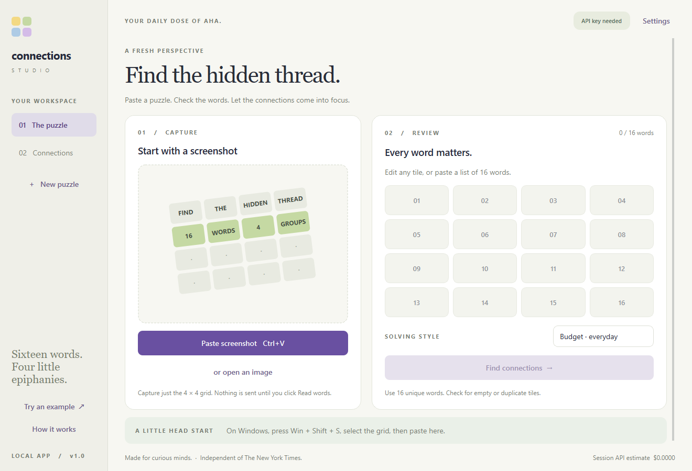
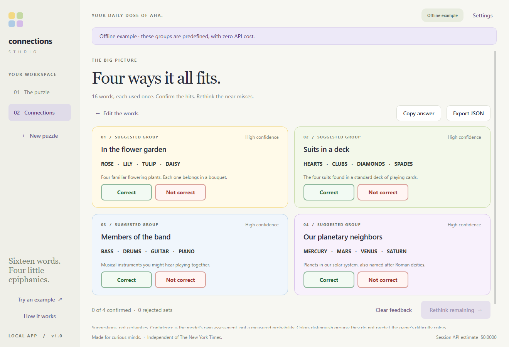

# Connections Studio

**Sixteen words. Four little epiphanies.**

A native Python desktop and terminal companion for Connections-style puzzles.
Copy a screenshot, paste it into the app, check the words, and explore four likely
groups with short explanations. No screenshot upload form, browser server or
Tesseract setup required.



## What it does

- **Paste first:** Ctrl+V / Cmd+V for a screenshot or word list. File open and
  drag-and-drop are also available.
- **Review before solving:** edit any of the 16 detected tiles, including phrases.
- **See the connection:** four color-coded groups with explanations and qualitative
  confidence. Every word must appear exactly once.
- **Refine the answer:** confirm correct groups, reject incorrect sets and rethink
  the remaining words.
- **Control costs:** budget/deeper modes, token limits, session cost estimates,
  cached identical requests and no automatic paid retries.
- **Try it free:** the offline example needs neither a key nor a connection.
- **Choose your provider:** OpenAI, Kimi, DeepSeek, or free local inference with Ollama.
- **Keep keys local:** session-only by default, with optional OS credential storage.
- **Use your terminal:** image path, clipboard, text file, direct words or JSON output.



AI suggestions can be wrong, especially on ambiguous wordplay. Confidence is the
model's self-assessment, **not a calibrated probability**. Colors distinguish groups;
they do not predict official difficulty colors. This project is independent of
and not endorsed by The New York Times.

## Quick start — Windows

Install **64-bit Python 3.11 or newer**. Open PowerShell in this project folder:

```powershell
py -3 -m venv .venv
.venv\Scripts\python -m pip install -e ".[desktop]"
.venv\Scripts\connections gui --demo
```

No environment activation is necessary with these commands. After setup,
double-click **`launch.cmd`** to open the app without leaving a terminal window
open. Or run `.venv\Scripts\connections` / `.venv\Scripts\python -m connections`.

### macOS / Linux

```bash
python3 -m venv .venv
source .venv/bin/activate
python -m pip install -e ".[desktop]"
connections gui --demo
```

Qt needs a graphical desktop. Linux may require your distribution's Qt platform
libraries (for example `libegl1`, `libopengl0`, `libxcb-cursor0` on Ubuntu).
macOS/Linux native appearance and clipboard behavior should be checked on those
platforms; local UI verification was performed on Windows.

## Providers and secure setup

For a complete walkthrough, see **[providers, private keys and local models](docs/providers-and-keys.md)**.

| Option | Default model | Best starting use |
| --- | --- | --- |
| OpenAI | `gpt-5.4-mini` | Cost-conscious hosted vision and reasoning |
| Ollama · local | `qwen3-vl:4b` | No per-request API charge; runs on your computer |
| Kimi / Moonshot | `kimi-k3.1-pro` | Alternative paid cloud provider |
| DeepSeek | `deepseek-flash` | Alternative paid cloud provider |

These are starting choices, not puzzle-accuracy rankings. API availability and
prices change. Free web chat access does not imply a free API.

### OpenAI

1. Open the [OpenAI API dashboard](https://platform.openai.com/) and choose/create
   a project. Review its [billing settings](https://platform.openai.com/settings/organization/billing/overview)
   and ensure API billing/credits are available. Check API billing separately
   from any ChatGPT subscription or promotional credits.
2. Create a secret key on the [API keys page](https://platform.openai.com/api-keys).
   Keep it private. The app needs permission to make Responses API requests.
3. Open **Settings → OpenAI**, paste the key and leave the default model.
4. For this session only, leave **Remember key** unchecked. To persist it,
   check **Remember key in the operating system credential store**. Click Save.
   On Windows this uses Credential Manager; no key is written to the project.

Terminal alternative (hidden prompt):

```powershell
.venv\Scripts\connections auth set --provider openai
```

OS storage cannot protect a key from malware or someone controlling your unlocked
account. Never put keys in source, GitHub, screenshots or issue reports. Revoke
and replace any leaked key. An optional `.env` is still supported, but it is
plaintext and only Git-ignored, not encrypted. Prefer the OS store.

### Free local inference

Install [Ollama](https://ollama.com/download/windows), disable its cloud features
as described in the [local setup guide](docs/providers-and-keys.md#run-a-free-local-model-with-ollama),
then run `ollama pull qwen3-vl:4b` (approximately 3.3 GB). Select **Ollama · local**
in Settings and Save. No key is required. Screenshots and words are processed on
your computer; there is no cloud fallback. Allow for model memory/runtime overhead,
electricity use and potentially weaker wordplay accuracy. [Model details](https://ollama.com/library/qwen3-vl).

For Kimi or DeepSeek, select that provider and enter its own API key. Full Kimi
open-weight models are too large for a typical laptop; Qwen3-VL is the practical
local starting point. Provider-specific instructions and sources are in the guide.

Official references: [API quickstart](https://developers.openai.com/api/docs/quickstart),
[API keys](https://platform.openai.com/api-keys),
[usage dashboard](https://platform.openai.com/usage).

## Everyday workflow

1. Open a **complete, unsolved 4×4 word grid** in the game.
2. On Windows, press **Win+Shift+S** and select just the grid. On macOS, use
   **Control+Command+Shift+4** to capture a region to the clipboard.
3. Press **Ctrl+V / Cmd+V** in Connections Studio or click Paste screenshot.
   The preview is local. **Pasting alone makes no API call.**
4. Click **Read words from image**. This sends the preview to your selected provider
   (or local Ollama). Cloud providers use API credits.
5. Check all 16 words and correct any misread tile. Click **Find connections** for
   a separate, text-only solve request.
6. Try a group in the game. If accepted, click **Correct**. If rejected, click
   **Not correct**, then **Rethink remaining**. Confirmed groups are kept locally;
   only unresolved words are sent for another solve. Rejected sets
   cannot recur under a different title.

Rethink resets the feedback button selections and removes old unresolved cards.
Confirmed groups remain labeled as kept; rejection history remains active. If the
provider fails or repeats a rejected set, the app shows an explicit failure state,
not the previous answer. Clear feedback removes the saved constraints.

Each rethink also sends the last 32 distinct arrangements tried for this puzzle,
including structurally valid answers refused for violating feedback. Confirmed
groups are removed from that context; the model must change the grouping of the
remaining words, not just names or ordering. The app rejects an unchanged remaining
partition. Unconfirmed individual groups may stay if the overall partition changes.
Clear feedback or a new board resets this in-memory search history. Additional
history increases input tokens. If only four previously tried words remain, undo
a confirmation before asking for a different arrangement; no paid request is sent.

You can type words directly or paste 16 entries separated by newlines, commas,
semicolons or tabs. Spaces inside phrases are preserved. Editing a tile clears
stale results and feedback; a new screenshot clears the old grid. Copy answers
as text or export suggestions/feedback to JSON.

Identical ordinary solve requests reuse the session cache. **Rethink remaining**
explicitly requests a fresh response and can incur another cloud charge. Add
feedback to rule out wrong sets, or select Deeper under **Edit the words**. A fresh
request can still reach the same conclusion if you do not reject it. The offline example is
predefined: it demonstrates the interface, not AI accuracy. Edit the board to
leave demo mode and use the live solver.

| Shortcut | Action |
| --- | --- |
| Ctrl+V / Cmd+V | Paste screenshot or word list |
| Ctrl+O / Cmd+O | Open image |
| Ctrl+Enter | Solve reviewed board |
| Ctrl+N / Cmd+N | New puzzle |
| Tab / Shift+Tab | Move between tiles and controls |

## OpenAI model and API cost

Default: **`gpt-5.4-mini`**, selected for current vision, reasoning and structured
output at a lower cost than a flagship model. This is a cost-conscious starting
point, **not a measured claim of best puzzle accuracy**.

Standard rates checked **October 30, 2026**:

| Model | Input / 1M tokens | Cached input / 1M | Output / 1M |
| --- | ---: | ---: | ---: |
| GPT-5.4 mini | $0.75 | $0.075 | $4.50 |

[Official model details and rates](https://developers.openai.com/api/docs/models/gpt-5.4-mini).
Rates and account availability can change.

| Operation | Reasoning | Output-token limit |
| --- | --- | ---: |
| Read screenshot | None | 1,200 |
| Budget solve | Low | 3,500 |
| Deeper solve | Medium | 6,500 |
| Extended solve | Medium | 16,000 |

Extended uses a five-minute request timeout instead of the standard 90 seconds.
Choose it explicitly under Solving style or pass `--mode extended`. It raises the
allowance, not the price per token, but can cost more if the model uses more tokens.
At the reference GPT-5.4 mini rate, 16,000 output tokens alone cost up to $0.072,
plus input and any image extraction. It does not guarantee completion or accuracy.
Reasoning uses the output allowance too: a token-budget error is not a timeout.

A **hypothetical** solve with 1,500 uncached input tokens and 2,000 total output
tokens costs approximately **$0.010125**, about one US cent. Image reading is
additional; actual tokens depend on the image and puzzle. Reasoning tokens count
as output. The budget solve's maximum output component alone is $0.01575;
this is **not a total per-puzzle spending cap**. There is no automatic escalation
or retry. Failed, incomplete and timed-out requests may still be billed.

Explore the offline demo for free, enter words directly to skip extraction cost,
and check project usage/billing controls before extended testing. The app shows
estimates from reported usage, not invoices. Unknown usage or custom model rates
make estimates incomplete. Check the provider's usage dashboard for actual charges.
Kimi/DeepSeek estimates are unavailable; local Ollama has zero API charges.

Advanced: override `CONNECTIONS_MODEL`, CLI `--model`, or Settings. A replacement
must support image input, structured Responses output and the configured reasoning
levels. Custom model costs are shown as unknown.

## Terminal usage

These commands assume an activated environment. On Windows, substitute
`.venv\Scripts\connections` to avoid activation. For **CLI only**, install with
`python -m pip install -e .`; Qt is not required.

```sh
# Free example
connections solve --demo
connections solve --demo --json

# Desktop
connections
connections gui --demo

# Solve a screenshot; quote paths containing spaces
connections solve --image "C:\Pictures\my grid.png"
connections solve --image ./examples/practice-grid.png --mode deeper --json

# Capture an image first, then read the clipboard directly
connections solve --clipboard

# Select a provider, or use the provider saved in desktop Settings
connections solve --clipboard --provider ollama
connections solve --image ./examples/practice-grid.png --provider kimi
connections solve --image ./examples/practice-grid.png --provider deepseek

# Store/remove keys without putting secrets in command history
connections auth set --provider openai
connections auth status --provider openai
connections auth forget --provider openai

# Extract, review/correct the file, then solve text only
connections extract --image ./examples/practice-grid.png > words.txt
connections solve --words-file words.txt

# Enter all tiles directly
connections solve --words "BASS,MERCURY,ROSE,HEARTS,MARS,CLUBS,DRUMS,LILY,DIAMONDS,TULIP,VENUS,GUITAR,DAISY,PIANO,SPADES,SATURN"

connections --help
connections solve --help
```

Terminals have no universal image attachment format. Use `--clipboard` for the
actual clipboard image, or drag a saved screenshot into your terminal to insert
its path after `--image`. Pasting an image into a terminal alone does not pass it
to the program. Clipboard support is most reliable on Windows/macOS; Linux depends
on the desktop and Pillow clipboard helpers. Use `--image` when unavailable.

`solve --image` and `solve --clipboard` explicitly perform **extraction plus solving**
(normally two model requests; paid for cloud providers). Use `extract` then
`--words-file` for manual review.
Text files are UTF-8, one tile per line. On Windows PowerShell 5.1, use
`connections extract ... | Set-Content -Encoding utf8 words.txt` instead of `>`
(which writes UTF-16 there).

`--json` emits only JSON on stdout; warnings/errors go to stderr. Exit codes:
0 success, 1 input/API error, 2 command syntax error, 130 interruption.
CLI feedback editing is not implemented; use the desktop to lock/reject groups.

## Privacy and limits

- Clipboard previews, puzzles and caches remain in memory. No screenshot history
  or telemetry. JSON export and answer copying happen only when requested.
- Explicit Read/Find/Rethink actions send input to the selected cloud provider or
  local Ollama. OpenAI requests use `store=False`, which is not a zero-retention guarantee. See
  [OpenAI data controls](https://developers.openai.com/api/docs/guides/your-data).
- Keys are separate per provider; optional persistence uses the native OS store.
  Local mode receives no cloud credentials. See the
  [security boundaries](docs/providers-and-keys.md#keep-keys-out-of-the-repository).
- Images are oriented, flattened to RGB, resized to a maximum 1600px longest side,
  and re-encoded without metadata. Limits: 12 MB, 25 megapixels, minimum 64px per
  side. PNG/JPEG/WebP/BMP are supported.
- Capture only the word grid to avoid sending unrelated personal content.
- Only full, unsolved text-based 16-tile grids are supported. Partial boards,
  solved banners, visual/rebus puzzles and tiny text need manual transcription.

## Troubleshooting

| Symptom | What to do |
| --- | --- |
| API key needed/rejected | Add a key in Settings; verify project and permissions. |
| Billing quota exhausted | Check API credits and project/organization billing limits. |
| Rate limited | Wait before trying again; there are no hidden retries. |
| Token budget exhausted | Review words/feedback; Extended allows 16,000 tokens and can cost more. |
| Wrong/missing words | Crop a sharper grid or edit tiles manually. |
| Clipboard has no image | Capture to clipboard or use Open image. |
| Window won't close yet | A request is running (90-second cloud / 180-second local; Extended uses 300 seconds); let it finish. |
| Cannot reach Ollama | Start Ollama; run `ollama pull qwen3-vl:4b`; check the selected model. |
| OS credential store locked | Unlock the keychain, or leave Remember unchecked for a session-only key. |
| Desktop support missing | Run `python -m pip install -e ".[desktop]"`. |
| Module not found | Install from this project folder with the same Python. |

## Development and publishing

```sh
python -m pip install -e ".[desktop,dev]"
python -m pytest -q
python -m ruff check src tests scripts
python -m ruff format --check src tests scripts
python -m build
```

See [CONTRIBUTING](CONTRIBUTING.md), [architecture](docs/architecture.md),
[verification](docs/verification.md), and the
[implementation plan](docs/superpowers/plans/2026-10-30-connections-studio.md).
GitHub Actions is configured for Windows/Linux with Python 3.11/3.13. All tests
are offline; no GitHub API-key secret is needed.

Before pushing, inspect `git status` and your staged diff. Include source, tests,
docs, examples, `pyproject.toml`, `.env.example` and the license. Exclude `.env`,
virtual environments, caches and personal screenshots. The old `config.py` and
its credentials are deliberately excluded from this rewrite.

Create an empty GitHub repository, add it as `origin`, and push your chosen branch.
The MIT license covers this project's code and original example assets; dependencies
retain their licenses (Qt/PySide6 uses LGPL/commercial terms). Review those terms
before distributing a bundled binary. No installer or hosted backend is included.
