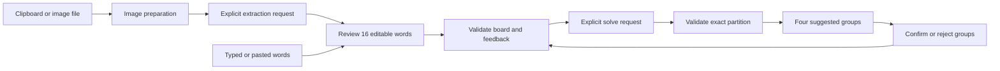

# Architecture

| File | Responsibility |
| --- | --- |
| `models.py` | Normalization, board, group and partition invariants |
| `config.py` | Provider selection, environment/vault/preferences precedence and reference rates |
| `providers.py` | Supported provider defaults and pinned official destinations |
| `credentials.py` | Explicit OS-native vault selection; no plaintext fallback |
| `preferences.py` | Separate provider/model and appearance preferences; never serializes keys |
| `images.py` | Decode, orient, flatten, resize and strip image metadata |
| `service.py` | OpenAI Responses, Kimi/DeepSeek chat, local Ollama, validation, cache and usage |
| `structured_output.py` | Concrete JSON examples and conservative JSON-mode parsing |
| `search.py` | Final-eight partition enumeration and feedback/history filtering |
| `fallback.py` | Feedback-respecting random test arrangements without model/category claims |
| `cli.py` | Arguments, text/JSON, exit codes and desktop dispatch |
| `demo.py` | Original offline sample, independent of live API behavior |
| `gui/window.py` | Workflow, puzzle state, feedback and worker lifecycle |
| `gui/widgets.py` | Visual components and image preview |
| `gui/settings_dialog.py` | Provider selection and explicit credential save/removal |
| `gui/theme.py` | Design tokens and Qt styles |
| `gui/worker.py` | Worker signals and exception boundary |
| `gui/dialogs.py` | Centered explicit-read prompt and nonblocking modal loading dialog |

Desktop and terminal share the solver. The desktop extra installs Qt Essentials;
no browser engine, local HTTP server or Tesseract executable is needed. CLI-only
users do not need Qt.

## Validation

Whitespace collapses and words normalize to uppercase; a phrase remains one tile.
Boards require 16 distinct nonempty entries of up to 80 characters each. Every
returned group contains four distinct words. The answer must use every input
exactly once. Locks cannot overlap; rejects exclude exact four-word sets regardless
of category title. All constraint words must belong to the board.

The model receives only unresolved words and applicable rejected sets. Its response
schema requires exactly the remaining number of groups. The core merges confirmed
groups locally, preserving their labels/explanations, then validates the full board.
No partial or invalid answer reaches the UI. Word edits
or image replacement clear stale results and feedback. All-confirmed puzzles return
locally.

Rethink consumes the displayed feedback selections but preserves the confirmed
groups and rejected-set history as constraints. Confirmations get a separate kept
label. Previous unresolved cards disappear before the request. On solve failure,
the desktop can replace them with explicitly labeled random test groups that
respect the same constraints; these are not model/category evidence. If no legal
fallback is found, old cards remain hidden and copy/export remain disabled.
Clear feedback removes constraints without
resurrecting hidden old suggestions.

`SolveRequest.previous_attempts` holds up to 32 complete, board-validated solutions.
The desktop records distinct word partitions from successes and structurally valid
constraint failures (via `ServiceError.attempt`), preserving history across provider
changes. Names, word order and group order do not create a distinct arrangement.
The service sends prior unresolved groups with category titles alongside rejected
sets. Local validation compares unresolved partitions against history; it does not
treat every previously unconfirmed individual group as wrong. A final four-word
set that has already been tried/rejected cannot be rearranged without unlocking a
confirmation, so that case errors before network work. History is included in
explicit exports and cleared on a new board or Clear feedback. It is not persisted
automatically. Historical groups also affect the ordinary solve cache key.

With exactly two confirmed groups, `remaining_options` anchors the first remaining
word and chooses three companions: C(7,3) = 35 unordered partitions. Any partition
containing a rejected set or matching prior unresolved membership is removed.
The model receives the surviving numbered options and returns an enum-constrained
`option_id`. The options use zero-based indexes into a single words array, avoiding
repeated long tile text and keeping local context use bounded. It also returns
exactly two `Category` descriptions in option order. Descriptions
contain no word lists; the service constructs `Group` objects from the selected
local option and performs full board/feedback validation. The same selection
schema works with Responses, JSON-mode chat and local Ollama. Invalid IDs or
malformed descriptions fail validation; an empty pool fails before network work.
This search constrains membership, not semantic correctness. The normal generator
remains in use with 4, 12 or 16 unresolved words. Only the selected partition
enters attempt history; other enumerated options remain available.

## API and usage

OpenAI's `client.responses.parse()` uses Pydantic schemas and `store=False`. Extraction uses
reasoning `none` / 1,200 output tokens; budget uses `low` / 3,500; deeper uses
`medium` / 6,500. Limits include reasoning tokens. Incomplete, refused or invalid
output is a recoverable error. SDK retries are disabled and timeout is 90 seconds.
A failed/timed-out request can still be billed.
Extended mode uses medium OpenAI reasoning, 16,000 output tokens and a 300-second
per-request timeout for every provider. Kimi/DeepSeek retain Deeper's reasoning.
Local context increases to output allowance plus 4,096 tokens (20,096 total).
Token-budget errors explicitly distinguish exhaustion from a network timeout.

Kimi and DeepSeek use official Chat Completions APIs with JSON mode, a schema in
the prompt, an exact-count output example and the same local validation. Kimi uses low/high reasoning; DeepSeek
disables/enables thinking. Unknown provider costs remain unavailable.
Only a whole Markdown JSON fence is unwrapped; no prose/reasoning is searched for
an answer and no missing fields/words are fabricated. Blank, malformed and schema-
mismatched answers receive separate errors with usage preserved. They are not retried.

Ollama uses its native `/api/chat` JSON schema format. Before sending puzzle data,
`/api/show` must describe a local GGUF model without remote metadata; image requests
also require vision capability. The client uses only `127.0.0.1:11434`, sends no
key and disables optional thinking. Budget/Deeper use an 8,192-token context and
180-second timeout; Extended uses the larger limits described above.
All clients disable environment proxies and redirects.
No automatic provider fallback is implemented.

A service instance caches at most 24 successful typed results in memory, keyed by
input/constraint hashes. Settings changes replace the service/cache. Cached returns
have zero new usage. Screenshots are not automatically saved. Costs use reported
token usage and reference rates; unknown usage/rates are marked incomplete.
Explicit Rethink bypasses the solve cache; confirmed-only boards still finish locally.

## UI concurrency

Provider calls run on Python daemon threads. Each Worker is a QObject created on
the main thread and emits queued signals to the window; only the main thread
touches widgets. A job registry retains workers until completion. Stop waiting
marks the job canceled, retires its service/client/cache, installs an independent
service, and restores controls immediately. Result and completion handlers check
worker identity so a retired job cannot alter newer work. Retired clients close
after their operation completes; an Event/Lock guard handles cancellation racing
with already-completed queued signals and guarantees one cleanup attempt. Late
signals are safe if Qt has shut down. Closing while actively waiting is deferred;
after stopping, daemon requests do not prevent app exit. Server computation and
billing may continue. Qt handles high-DPI scaling; small windows scroll vertically.

The desktop defaults to Extended; CLI/core defaults remain Budget. A pasted image
opens a centered prompt; only its Read action starts extraction. Loading uses a
nonblocking window-modal dialog while the worker runs. Stop waiting, Escape and
close request local cancellation; they do not promise server-side cancellation.
Both popups recenter when their parent moves/resizes. Theme and
sidebar state live in a separate, nonsecret `appearance.json`; provider Settings
cannot overwrite them. The results action becomes New puzzle after all groups
are confirmed, clearing puzzle state without a discard confirmation in that case.

Random fallback uses the final-eight enumerator when applicable; otherwise it
tries at most 256 local shuffles. Every candidate is fully validated against the
board, confirmations, rejections and history. No words are fabricated and confirmed
groups keep their labels. Unresolved groups use explicit Random test titles and
unscored UI labels, not invented semantic explanations. Copied text and JSON
exports identify random origin. A missing fallback is not proof that a 12/16-word
board has no solution; the bounded local sampling may simply find none. Only solve
failure/cancellation triggers fallback; extraction errors do not guess unseen words.

## Privacy boundary

Clipboard/file reading is local. Read words sends a normalized image to the chosen provider;
Find/Rethink sends words and feedback. CLI `solve --image` asks for both requests;
`extract` separates them for manual review. There is no game scraping or telemetry.
Settings keys are session-only unless the user explicitly enables OS credential
storage. Provider/model preferences contain no secret. Credentials are isolated by
provider; no cloud key enters the Ollama settings. An explicitly created `.env` is
plaintext and Git-ignored. Native backend selection excludes plaintext keyring
plugins. OS storage cannot protect against a compromised OS account. Cloud-side
retention is governed by each provider's policies, not the app's in-memory design.
