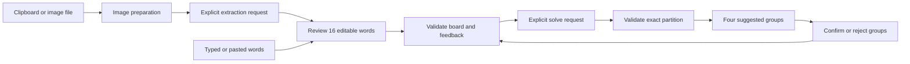

# Architecture

| File | Responsibility |
| --- | --- |
| `models.py` | Normalization, board, group and partition invariants |
| `config.py` | Explicit environment loading, model and reference token rates |
| `images.py` | Decode, orient, flatten, resize and strip image metadata |
| `service.py` | OpenAI SDK, typed output, errors, bounded cache and usage |
| `cli.py` | Arguments, text/JSON, exit codes and desktop dispatch |
| `demo.py` | Original offline sample, independent of live API behavior |
| `gui/window.py` | Workflow, puzzle state, feedback and worker lifecycle |
| `gui/widgets.py` | Visual components, preview and settings |
| `gui/theme.py` | Design tokens and Qt styles |
| `gui/worker.py` | Worker signals and exception boundary |

Desktop and terminal share the solver. The desktop extra installs Qt Essentials;
no browser engine, local HTTP server or Tesseract executable is needed. CLI-only
users do not need Qt.

## Validation

Whitespace collapses and words normalize to uppercase; a phrase remains one tile.
Boards require 16 distinct nonempty entries of up to 80 characters each. Every
returned group contains four distinct words. The answer must use every input
exactly once. Locks cannot overlap; rejects exclude exact four-word sets regardless
of category title. All constraint words must belong to the board.

The model returns all groups including locks; the core validates them and restores
locked labels/explanations. No partial or invalid answer reaches the UI. Word edits
or image replacement clear stale results and feedback. All-confirmed puzzles return
locally.

## API and usage

`client.responses.parse()` uses Pydantic schemas and `store=False`. Extraction uses
reasoning `none` / 1,200 output tokens; budget uses `low` / 3,500; deeper uses
`medium` / 6,500. Limits include reasoning tokens. Incomplete, refused or invalid
output is a recoverable error. SDK retries are disabled and timeout is 90 seconds.
A failed/timed-out request can still be billed.

A service instance caches at most 24 successful typed results in memory, keyed by
input/constraint hashes. Settings changes replace the service/cache. Cached returns
have zero new usage. Screenshots are not automatically saved. Costs use reported
token usage and reference rates; unknown usage/rates are marked incomplete.

## UI concurrency

One Worker lives on a QThread per operation. The main thread owns widget state.
Puzzle/settings controls are disabled during work. Workers emit data/errors by
signals. Closing is deferred while busy, preventing destruction of a running
thread. Errors preserve the puzzle. Qt handles high-DPI scaling; small windows
scroll vertically.

## Privacy boundary

Clipboard/file reading is local. Read words sends a normalized image to OpenAI;
Find/Rethink sends words and feedback. CLI `solve --image` asks for both requests;
`extract` separates them for manual review. There is no game scraping or telemetry.
Settings keys are session-only. An explicitly created `.env` is plaintext and
Git-ignored. Service-side retention is governed by OpenAI's policies, not the
app's in-memory design.
