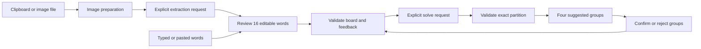

# Architecture

| File | Responsibility |
| --- | --- |
| `models.py` | Normalization, board, group and partition invariants |
| `config.py` | Provider selection, environment/vault/preferences precedence and reference rates |
| `providers.py` | Supported provider defaults and pinned official destinations |
| `credentials.py` | Explicit OS-native vault selection; no plaintext fallback |
| `preferences.py` | Provider/model preferences only; never serializes keys |
| `images.py` | Decode, orient, flatten, resize and strip image metadata |
| `service.py` | OpenAI Responses, Kimi/DeepSeek chat, local Ollama, validation, cache and usage |
| `cli.py` | Arguments, text/JSON, exit codes and desktop dispatch |
| `demo.py` | Original offline sample, independent of live API behavior |
| `gui/window.py` | Workflow, puzzle state, feedback and worker lifecycle |
| `gui/widgets.py` | Visual components and image preview |
| `gui/settings_dialog.py` | Provider selection and explicit credential save/removal |
| `gui/theme.py` | Design tokens and Qt styles |
| `gui/worker.py` | Worker signals and exception boundary |

Desktop and terminal share the solver. The desktop extra installs Qt Essentials;
no browser engine, local HTTP server or Tesseract executable is needed. CLI-only
users do not need Qt.

## Validation

Whitespace collapses and words normalize to uppercase; a phrase remains one tile.
Boards require 16 distinct nonempty entries of up to 80 characters each. Every
returned group contains four distinct words. The answer must use every input
exactly once. Locks cannot overlap; rejects exclude exact four-word sets regardless
of category title. All constraint words must belong to the board.

The model receives only unresolved words and applicable rejected sets. Its response
schema requires exactly the remaining number of groups. The core merges confirmed
groups locally, preserving their labels/explanations, then validates the full board.
No partial or invalid answer reaches the UI. Word edits
or image replacement clear stale results and feedback. All-confirmed puzzles return
locally.

Rethink consumes the displayed feedback selections but preserves the confirmed
groups and rejected-set history as constraints. Confirmations get a separate kept
label. Previous unresolved cards disappear before the request and stay hidden on
failure; the UI explicitly says no new answer was accepted. Copy/export are disabled
until a valid replacement arrives. Clear feedback removes constraints without
resurrecting hidden old suggestions.

## API and usage

OpenAI's `client.responses.parse()` uses Pydantic schemas and `store=False`. Extraction uses
reasoning `none` / 1,200 output tokens; budget uses `low` / 3,500; deeper uses
`medium` / 6,500. Limits include reasoning tokens. Incomplete, refused or invalid
output is a recoverable error. SDK retries are disabled and timeout is 90 seconds.
A failed/timed-out request can still be billed.

Kimi and DeepSeek use official Chat Completions APIs with JSON mode, a schema in
the prompt and the same local validation. Kimi uses low/high reasoning; DeepSeek
disables/enables thinking. Unknown provider costs remain unavailable.

Ollama uses its native `/api/chat` JSON schema format. Before sending puzzle data,
`/api/show` must describe a local GGUF model without remote metadata; image requests
also require vision capability. The client uses only `127.0.0.1:11434`, sends no
key, disables optional thinking, caps context at 8,192 and times out after 180
seconds per request. All clients disable environment proxies and redirects.
No automatic provider fallback is implemented.

A service instance caches at most 24 successful typed results in memory, keyed by
input/constraint hashes. Settings changes replace the service/cache. Cached returns
have zero new usage. Screenshots are not automatically saved. Costs use reported
token usage and reference rates; unknown usage/rates are marked incomplete.
Explicit Rethink bypasses the solve cache; confirmed-only boards still finish locally.

## UI concurrency

One Worker lives on a QThread per operation. The main thread owns widget state.
Puzzle/settings controls are disabled during work. Workers emit data/errors by
signals. Closing is deferred while busy, preventing destruction of a running
thread. Errors preserve the puzzle. Qt handles high-DPI scaling; small windows
scroll vertically.

## Privacy boundary

Clipboard/file reading is local. Read words sends a normalized image to the chosen provider;
Find/Rethink sends words and feedback. CLI `solve --image` asks for both requests;
`extract` separates them for manual review. There is no game scraping or telemetry.
Settings keys are session-only unless the user explicitly enables OS credential
storage. Provider/model preferences contain no secret. Credentials are isolated by
provider; no cloud key enters the Ollama settings. An explicitly created `.env` is
plaintext and Git-ignored. Native backend selection excludes plaintext keyring
plugins. OS storage cannot protect against a compromised OS account. Cloud-side
retention is governed by each provider's policies, not the app's in-memory design.
