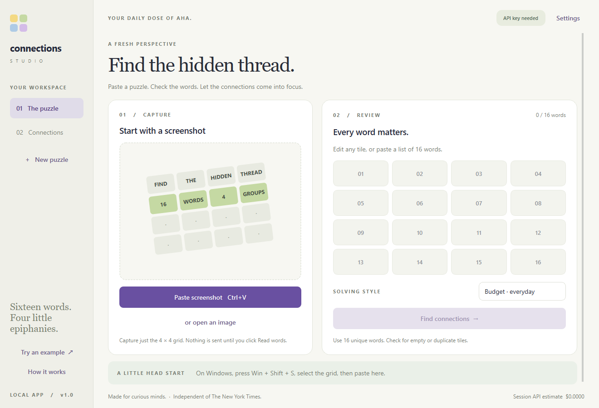
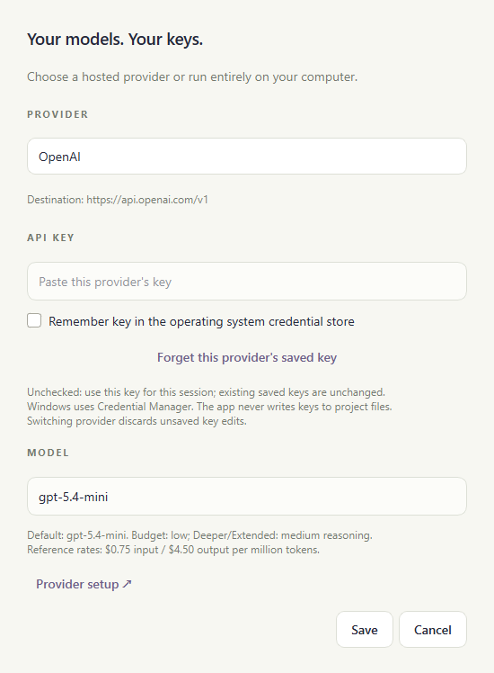
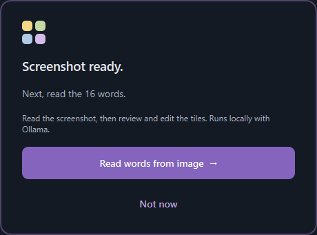
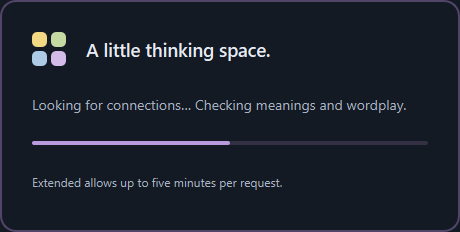
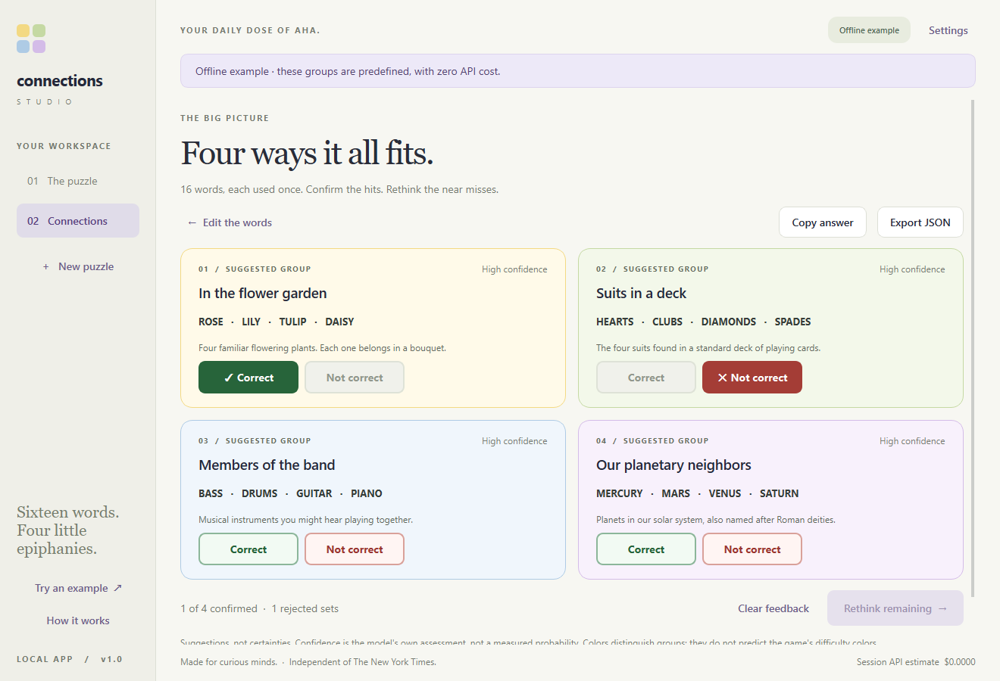
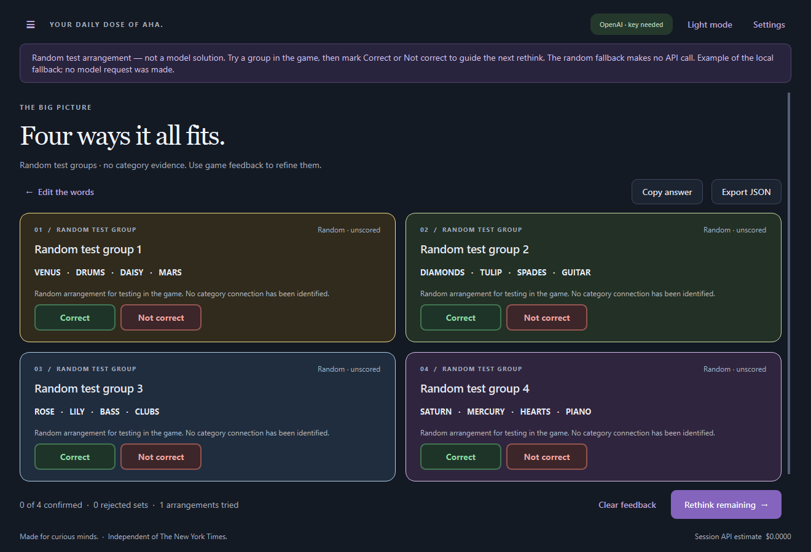
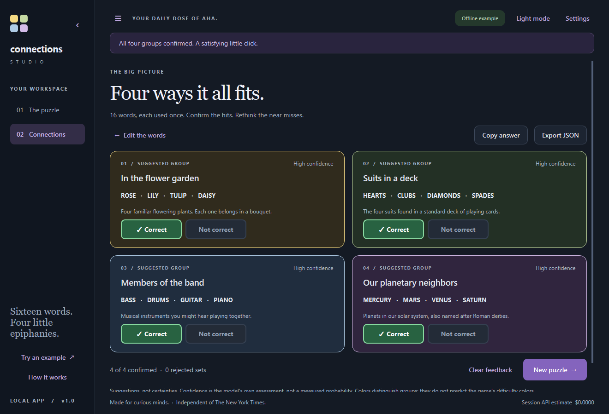

# Your first puzzle

## 1. Install and explore without spending money

Install Python 3.11+ and follow the [README's installation steps](../README.md#quick-start--windows).
Run the predefined offline example:

```powershell
.venv\Scripts\connections gui --demo
```

Click **Reveal example groups** to explore the controls. This is predefined demo
data, not a live model request or an accuracy benchmark.



## 2. Choose where the model runs

Open **Settings**. For OpenAI, DeepSeek or Kimi, create your own provider API key,
check API billing separately from any chat subscription, select the matching
provider, paste its key and Save. Check Remember only if you want OS credential
storage. Leave the default model initially. The desktop starts in Extended mode;
choose Budget for a smaller allowance when testing cloud models.



For local inference, install Ollama, download `qwen3-vl:4b`, select **Ollama · local**
and Save. No API key is required. Local inference has no per-request API bill but
requires storage, memory, compute and electricity. Follow the
[complete local-model and provider setup guide](providers-and-keys.md).

## 3. Paste the grid and read its words

Open a complete, unsolved 4×4 game grid. On Windows, use **Win+Shift+S** to copy a
crop of just the grid, then press **Ctrl+V** in the app. Pasting itself is local.
The centered popup makes the next action explicit:



Click **Read words from image** to submit the screenshot to your chosen provider,
or Not now to return to the preview. Cloud extraction can cost money. Review and
correct all 16 tiles; multiword phrases belong in a single tile. You can instead
paste a word list and skip image extraction.

## 4. Solve and give feedback

Click **Find connections**. The centered loading popup has **Stop waiting** if a
request takes too long. A stopped request may still compute or be billed by its
provider; late answers cannot overwrite your current puzzle.



Try suggested groups in the actual game. Click **Correct** only after the game
accepts the exact four words. Click **Not correct** after a rejection, then use
**Rethink remaining**. Confirmed groups stay fixed; rejections and previous
arrangements guide the next request. With eight words left, the app enumerates
all 35 splits locally and asks the model to choose an allowed one.



If a solve fails or is stopped, a permitted random arrangement may appear. Cards
explicitly say **Random test group** and **Random · unscored**: they are guesses
for collecting game feedback, not categories the model has identified. Random
generation makes no API call. It never invents unreadable words or overrides
confirmed/rejected constraints.



## 5. Finish or start another puzzle

Once all four groups are marked Correct, the results action becomes **New puzzle**.
Click it to return directly to an empty workspace. Copy/export are explicit actions.
Light/dark mode and sidebar visibility are saved locally and can be changed from
the top bar. The menu button reopens the sidebar.



## Terminal examples

From the project folder on Windows:

```powershell
# Hidden prompt; the key never becomes a command-line argument
.venv\Scripts\connections auth set --provider openai

# Copy a screenshot first, then run a cloud solve
.venv\Scripts\connections solve --clipboard --provider openai --mode budget

# Or use an installed local Ollama model
.venv\Scripts\connections solve --image "grid.png" --provider ollama

# Extract to a file for review before solving
.venv\Scripts\connections extract --image "grid.png" --provider deepseek |
    Set-Content -Encoding utf8 words.txt
.venv\Scripts\connections solve --words-file words.txt --provider deepseek
```

CLI image solves perform extraction and solving sequentially. Use `extract` first
when you want manual review. Terminal commands default to Budget; use `--mode
extended` explicitly for a larger allowance. See [all terminal options](../README.md#terminal-usage).

## If something goes wrong

Check the selected provider/model, key, billing and local Ollama installation first.
Model answers are suggestions and can be wrong. Deeper/Extended may use more tokens
and cost more; a larger allowance does not guarantee a correct answer. See the
[troubleshooting table](../README.md#troubleshooting). When reporting a bug, include
the visible error, provider/model, OS and reproduction steps, never your API key.
